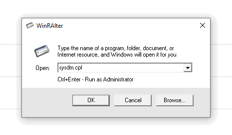

# WinRAlter

Небольшая Windows-утилита для быстрого запуска команд через графический интерфейс. Альтернатива Win+R

## Возможности

- запуск команд через Windows Shell;
- история ранее выполненных команд;
- автодополнение команд;
- удаление текущей команды из истории по Ctrl+Shift+Delete;

